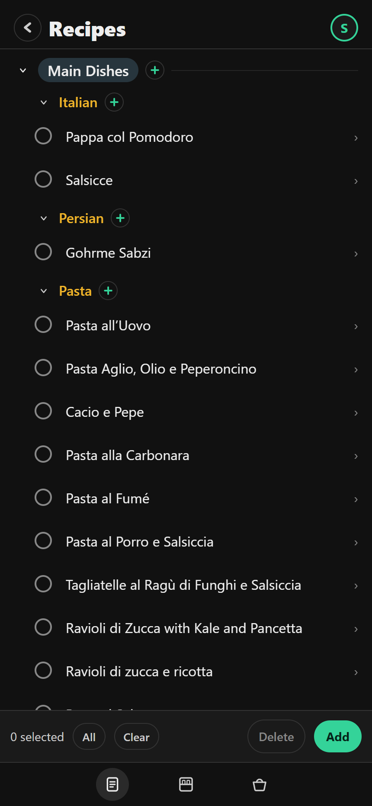
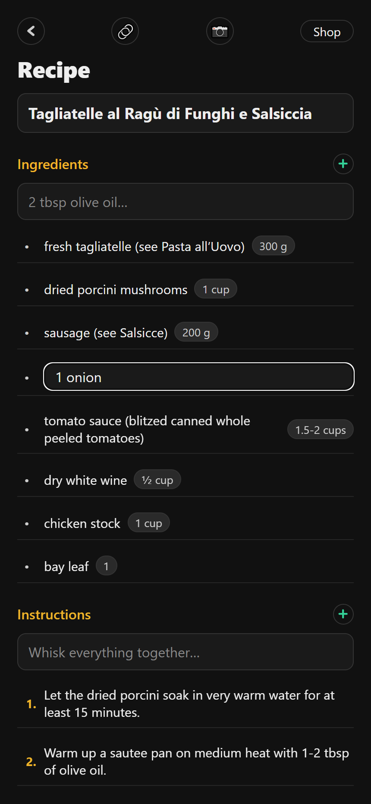
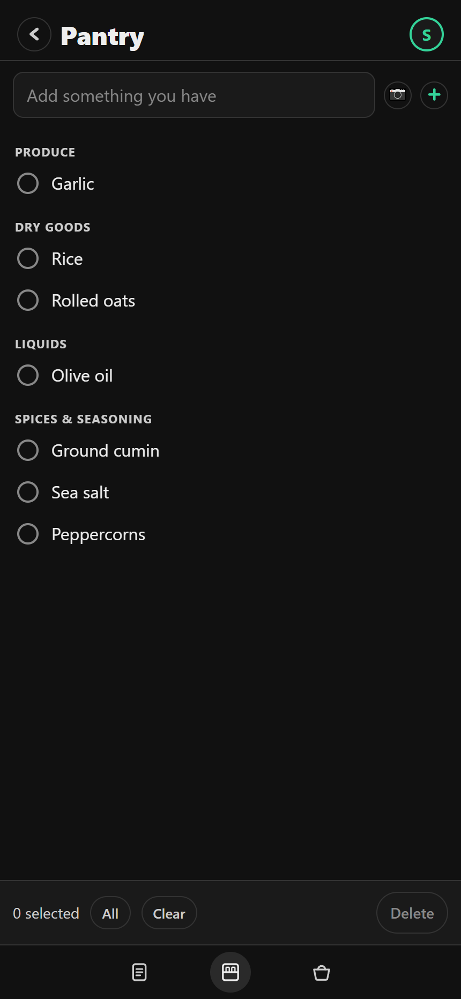
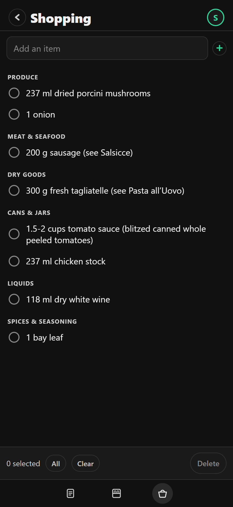

# ChefMind

Recipes, a pantry and a shopping list.

## Disclaimer

Feel free to deploy this on your own website, build and deploy the iOS version, etc.

**This is a personal project to have some fun with claude code, which generated essentially all of the code, and the rest of this readme:**

## Quick start / Install

- Web: [seancheren.com/ChefMind](https://seancheren.com/ChefMind). Installs as a PWA. Sign in with a CalMind account.
- macOS and Windows: installers on [GitHub Releases](https://github.com/chere005/ChefMind/releases). Unsigned.
- iOS and Android: build from source, see Building.

## Platforms

- Web (PWA)
- iOS and Android
- macOS and Windows (Tauri desktop app)

## Usage

### Recipes

Recipes in folders. Tick the ones you mean to cook and press *Add to shopping list*.



### Recipe editor

Ingredients, quantities and steps.



### Pantry

What you have, typed in or scanned from a receipt. Pantry items are left off the shopping list.



### Shopping list

Ingredients combined and grouped by aisle.



## Notes

- Three tabs: Recipes · Pantry · Shopping.
- Uses CalMind accounts. No server of its own; records live on CalMind's.

## Building

```sh
npm install
npm run export:web && node tools/patch-web-html.mjs app/dist/index.html
CALMIND_DATA_DIR=/tmp/chefmind-dev-data php -S 127.0.0.1:8792 e2e-router.php   # then http://127.0.0.1:8792/ChefMind/
```

Needs a sibling `../CalMind` checkout. Phones: `sh tools/build-platforms.sh --ios` or `--android`. Desktop: `npm run desktop`. Release: `npm run dtp` (or `tdtp`, tests first); the tag builds the installers on GitHub.

## Documentation

- [ARCHITECTURE.md](ARCHITECTURE.md): the tree, the screens, accounts and store, deploy and release lanes.
- [AGENTS.md](AGENTS.md): rules for anyone, human or agent, changing the code.

## Contributing

Issues and pull requests are welcome. Read AGENTS.md first; `npm test` and `npm run typecheck` must pass. BSD 3-Clause, see [LICENSE](LICENSE).
